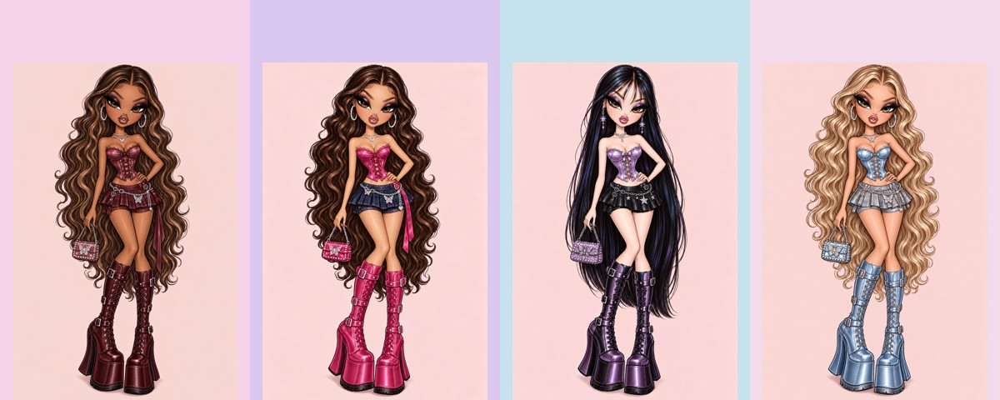

# Mall Dolls ✦

**A multiplayer Y2K fashion challenge**

[Play Mall Dolls](https://mall-dolls-kelsey.kelseymartinez12.chatgpt.site)

Mall Dolls is a multiplayer fashion game for **2–8 players**, each on their own device. Players style illustrated dolls to match a theme, compete on the runway, and vote for their favorite looks.

*Character lineup artwork from the game. A verified homepage screenshot has not yet been added.*

## Game features

- **Private multiplayer rooms:** host a party, share a room code, and join from separate devices.
- **Four playable dolls:** choose a character and nickname.
- **Three fashion themes:** Cyberpunk, Dollette, and Glamoratti.
- **Timed styling:** 60 seconds to build a look for each round.
- **Runway voting:** 8 seconds per look and a 1–4 star rating system; players cannot vote for themselves.
- **Scoring and winners:** average ratings determine round scores; the highest total after three rounds wins.
- **Theme-specific wardrobes:** 96 clothing and accessory pieces across eight categories.
- **Owner-only Fitting Studio:** adjust garment placement, scale, rotation, and shapes without exposing editing controls to players.
- **Server-validated game rules:** enforces shopping deadlines, item availability, voting windows, and rematches.

## How to play

1. Choose your doll and nickname.
2. Host a room or join with a friend's code.
3. When all players are ready, the host starts the game.
4. Style an outfit during each 60-second shopping round.
5. Vote on other players' runway looks, then compete for the final crown.

## Technology and architecture

The live game uses **React, TypeScript, Cloudflare Workers, and D1 storage**. This repository is a **portfolio showcase** with selected implementation files and artwork, not the complete live application.

- [Game rules and scoring](src/game.ts)
- [Wardrobe fitting logic](src/fittings.ts)
- [Character lineup](media/mall-dolls-lineup.jpg)

## Homepage screenshot

To display an authentic homepage capture, add `media/homepage.png` and embed it here:

``

## What I learned

I designed the game concept, fashion themes, doll aesthetic, and gameplay flow using AI-assisted development. A major challenge was aligning illustrated garments to different doll shapes. Building a private Fitting Studio made it easier to refine pieces without changing the player experience.
